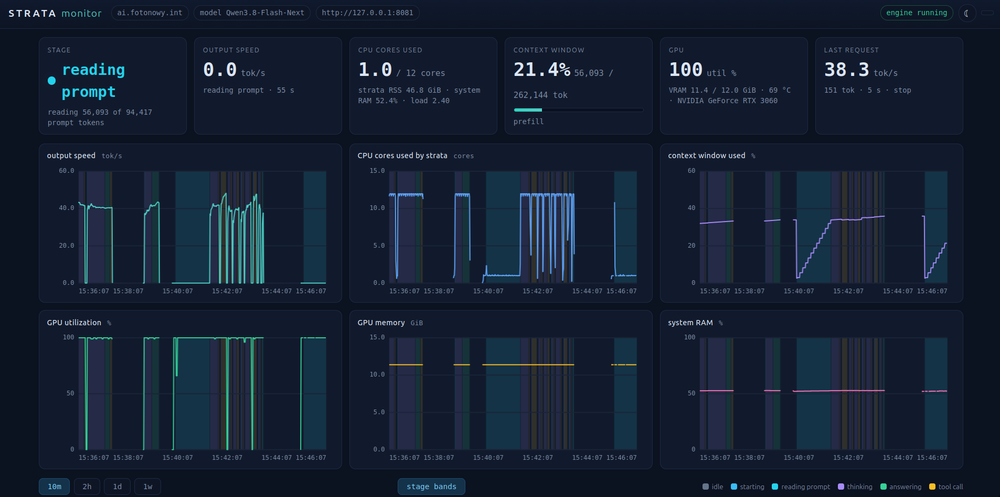
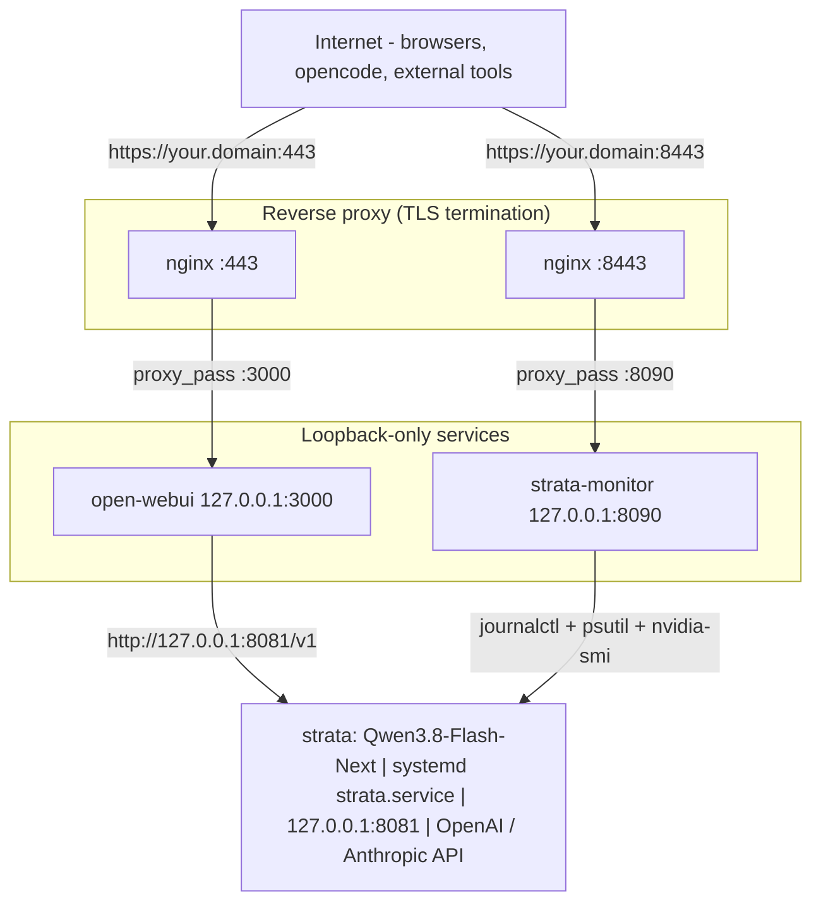

# Strata Monitor

**Monitor your local LLM.** A live lightweight web dashboard for
[**Strata**](https://github.com/Niko1221/Strata) — the free, open-source
inference engine that runs 125B-parameter models on consumer hardware.
Strata runs the model; this project watches it. 
Point it at the `strata.service` journal and it shows you, in real time, 
- which stage the engine is in (thinking / answering / tool call / prefill), 
- how fast it generates tokens, 
- how full the context window is, and 
- how your GPU/CPU/RAM are holding up.
All on a single page with hand-rolled canvas charts (no CDN, no web framework).



## Features

- **Engine stage** with colored background bands on the time-series
- **Tokens/s** with rolling history
- **Context window** usage
- **Live CPU cores, RAM, GPU** (utilization, VRAM, temperature, power)
- **Time-series plots** (hand-rolled canvas, no external assets)
- **Systemd journal backfill** to reconstruct history at real timestamps
- **SQLite (WAL) storage**, 14-day retention
- **Pure Python 3 stdlib + `psutil`**, no web framework, no CDN
- **Plain HTTP on `127.0.0.1` only**; nginx in front for HTTPS — TLS is
  the proxy's job, the monitor never needs the private key

## Architecture



Five components, three trust zones:

1. **strata** — the LLM inference engine. Runs Qwen3.8-Flash-Next
   (a 125B-parameter mixture-of-experts model) on your CPU/GPU. Managed as a
   systemd unit (`strata.service`); exposes an OpenAI/Anthropic-compatible API
   on `http://127.0.0.1:8081` — loopback only, not reachable from the network.
   See <https://github.com/Niko1221/Strata>.

2. **open-webui** — a web chat frontend. Connects to strata on
   `http://127.0.0.1:8081/v1` and serves its UI on `127.0.0.1:3000`. Also
   mints API keys that **external tools** (opencode, coding agents, custom
   harnesses) use to call the model through the same OpenAI-compatible
   endpoint proxied by nginx — point the tool's `base_url` at
   `https://<your.domain>/v1` and paste the key.

3. **nginx on :443** — TLS reverse proxy in front of open-webui. Terminates
   HTTPS for `https://<your.domain>` and forwards plain HTTP to
   `127.0.0.1:3000`. Owns the certificate and the private key.

4. **strata-monitor (this project)** — reads `strata.service`'s systemd
   journal plus live CPU/RAM/GPU samples and renders the dashboard on
   `http://127.0.0.1:8090`. Plain HTTP, loopback-only, no auth — by design.

5. **nginx on :8443** — second TLS reverse proxy, on a non-standard port so
   it can coexist with the open-webui proxy on :443. Forwards
   `https://<your.domain>:8443` to the monitor at `127.0.0.1:8090`. A
   ready-made config ships in `deploy/strata-monitor.nginx-port8443.conf`.

External users reach the chat at `https://<your.domain>`. The monitor lives
at `https://<your.domain>:8443` for ops and debugging only.

## Install (Ubuntu 24.04, root)

On the machine running the strata engine (needs local journal + GPU access):

```sh
sudo ./install.sh          # installs python3-psutil if missing, installs the
                           # systemd unit and starts it
```

Dashboard: `https://<host>/` through nginx (the monitor itself listens on
`http://127.0.0.1:8090/` and is not reachable from the network)
Config: `/etc/strata-monitor/config.json` (restart the unit after editing)
Logs: `journalctl -u strata-monitor -f`

## Uninstall (root)

`uninstall.sh` reverses `install.sh`: it stops and disables the unit, removes
the systemd unit (+ any drop-ins), and deletes `/opt/strata-monitor` and
`/etc/strata-monitor`. The SQLite data in `/var/lib/strata-monitor/` is **kept**
by default.

```sh
sudo ./uninstall.sh              # stop+disable, remove app + config, keep data
sudo ./uninstall.sh --dry-run    # preview what would be removed
sudo ./uninstall.sh --purge      # also delete /var/lib/strata-monitor (history)
sudo ./uninstall.sh --keep-config   # leave /etc/strata-monitor in place
sudo ./uninstall.sh --purge-deps    # also remove python3-psutil
```

### Database

All history lives in the SQLite file at the `db` path (default
`/var/lib/strata-monitor/monitor.db`, plus WAL sidecars `monitor.db-wal` /
`monitor.db-shm`). `uninstall.sh` keeps it unless you pass `--purge`, which
deletes the whole `/var/lib/strata-monitor/` state directory.

To wipe history but keep the service installed:

```sh
sudo systemctl stop strata-monitor
sudo rm -f /var/lib/strata-monitor/monitor.db /var/lib/strata-monitor/monitor.db-wal /var/lib/strata-monitor/monitor.db-shm
sudo systemctl start strata-monitor   # an empty DB is recreated on start
```

The nginx site and any firewall rule were created by you (not by `install.sh`),
so they are left for you to remove:

```sh
sudo rm /etc/nginx/sites-{available,enabled}/strata-monitor
sudo nginx -t && sudo systemctl reload nginx
sudo ufw delete allow 8443/tcp        # whichever port you opened
```

## Config

By default kept in **/etc/strata-monitor/config.json**.

| key                | default                     | meaning                                              |
|--------------------|-----------------------------|------------------------------------------------------|
| `unit`             | `strata.service`            | systemd unit followed for engine lifecycle           |
| `bind` / `port`    | `127.0.0.1` / `8090`        | HTTP listen address (loopback by default)            |
| `log_file`         | `null`                      | null = live journal; a path = replay that file       |
| `file_position`    | `end`                       | replay start: `end` or `start`                       |
| `preload_hours`    | `24`                        | backfill this much history on startup                |
| `sample_interval_s`| `1.0`                       | sampling while engine is active                      |
| `idle_interval_s`  | `10.0`                      | sampling while engine is idle                        |
| `gpu_interval_s`   | `3.0`                       | `nvidia-smi` polling interval                        |
| `retention_days`   | `14`                        | prune samples older than this                        |
| `stale_after_s`    | `30`                        | engine marked stale if no log line for this long     |
| `db`               | `/var/lib/strata-monitor/monitor.db` | SQLite database                           |

> **Don't set `bind` to `0.0.0.0`.** The monitor serves plain HTTP with no auth;
> `0.0.0.0` exposes port 8090 to the whole network. Keep `127.0.0.1` and let the
> nginx proxy be the only network-facing entry point (see below).

## HTTPS via nginx

The monitor is plain HTTP bound to `127.0.0.1`, so it is only reachable through
a reverse proxy. Two ready-made nginx templates ship in `deploy/` (also copied
to `/etc/strata-monitor/` by `install.sh`). Cert paths are placeholders — edit
them per host; nothing is baked into the app:

- `strata-monitor.nginx.conf` — dedicated host on **443** (own `server_name`).
- `strata-monitor.nginx-port8443.conf` — extra site on **8443**, for when you
  already have a site on 443 and don't want new DNS.

```sh
# pick one, e.g. the port variant:
sudo cp /etc/strata-monitor/strata-monitor.nginx-port8443.conf /etc/nginx/sites-available/strata-monitor
sudo ln -s /etc/nginx/sites-available/strata-monitor /etc/nginx/sites-enabled/
# edit server_name + ssl_certificate / ssl_certificate_key (e.g. /etc/ssl/private/ai.key)
sudo nginx -t && sudo systemctl reload nginx
sudo ufw allow 8443/tcp        # if you have a firewall
```

The template terminates TLS, sets `Strict-Transport-Security`, and `proxy_pass`es
to `http://127.0.0.1:8090`. The private key stays owned by nginx/root; the
monitor never reads it. If you must expose the monitor directly on a LAN, set
`bind` in `config.json` and firewall the port yourself — you lose HTTPS.

## Local testing (replay mode)

Without journal access you can replay a log file:

```sh
python3 src/monitor.py \
  --log-file /path/to/strata.log \
  --file-position start --port 8090 --bind 127.0.0.1
```

Then open `http://127.0.0.1:8090/`. The monitor is always plain HTTP; HTTPS is
provided by the nginx proxy in production.

## Layout

```
src/
  monitor.py     entry point, config merge, shutdown
  parser.py      journal line -> typed events
  collector.py   journal follower + CPU/GPU/RAM sampler + state machine
  store.py       SQLite time-series store, bucketed history, pruning
  server.py      stdlib HTTP API + static files
  static/        dashboard (index.html, style.css, app.js)
config.json          production defaults (installed to /etc/strata-monitor/)
deploy/              nginx HTTPS templates (443 host + 8443 port variants)
strata-monitor.service  systemd unit (hardened, DynamicUser)
install.sh        one-shot installer
uninstall.sh      one-shot remover
docs/             screenshot used in README.md
```

### Stages

`idle`, `starting`, `prefill`, `thinking`, `answering`, `tool_call`,
`stopped`, `error` — logged in `/api/state` and used as the plot background bands.

## API

- `GET /api/state` — live snapshot (stage, tok/s, context, CPU, GPU, last request)
- `GET /api/history?window=3600` — bucketed time series (window in seconds)
- `GET /api/health` — process liveness
